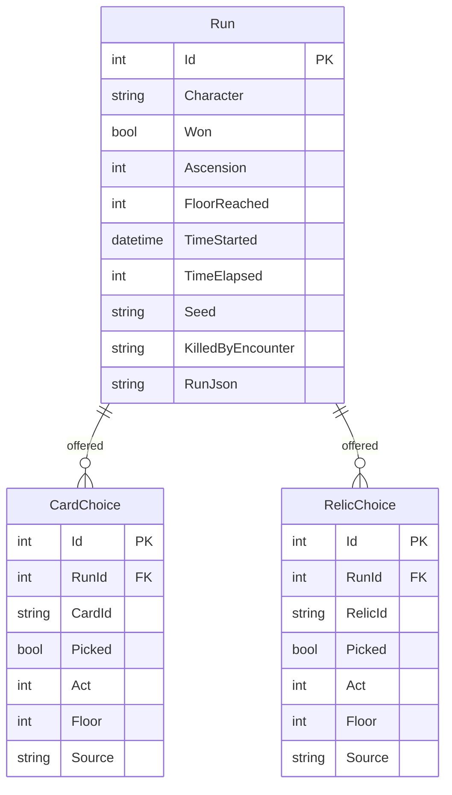
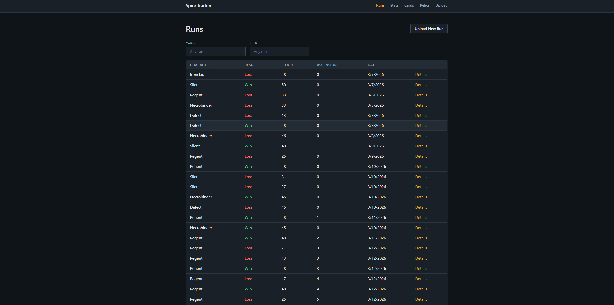
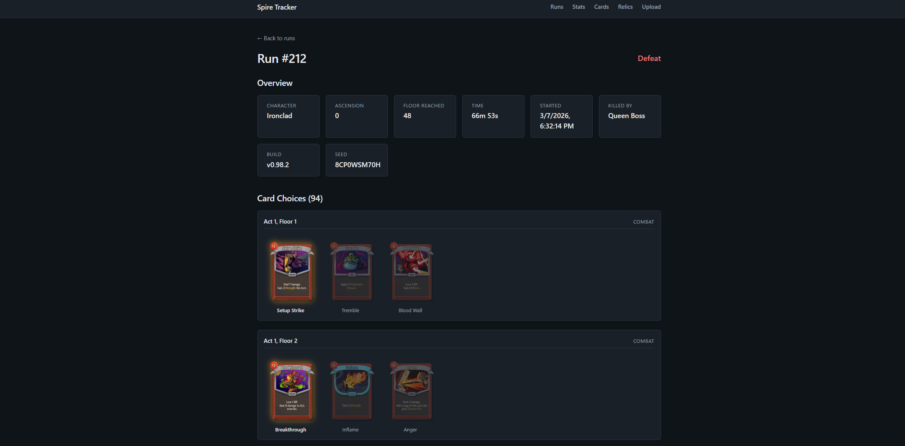
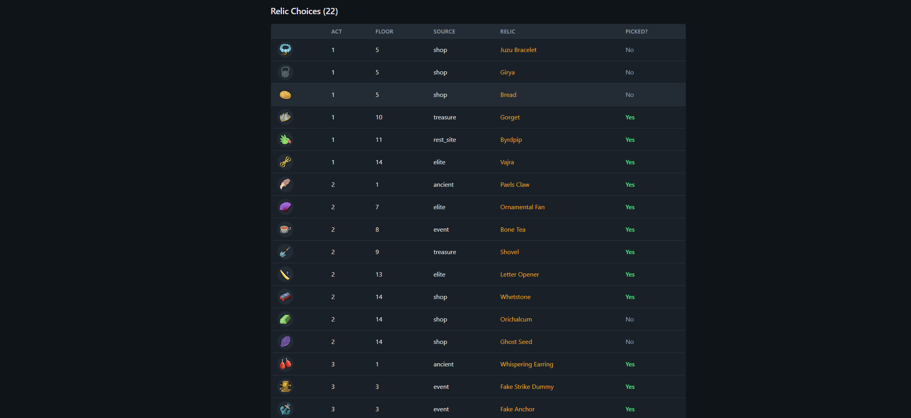
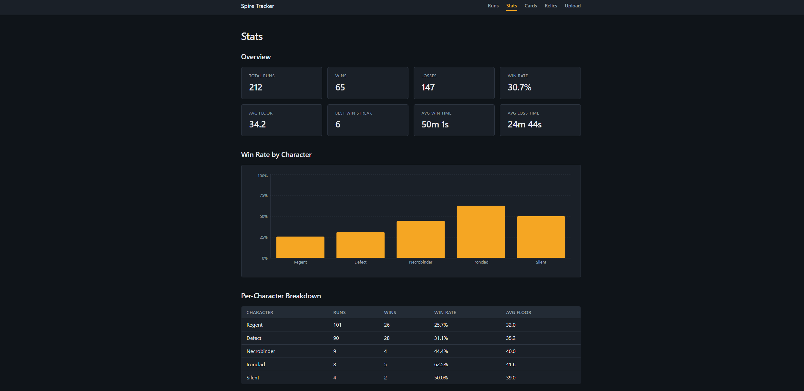
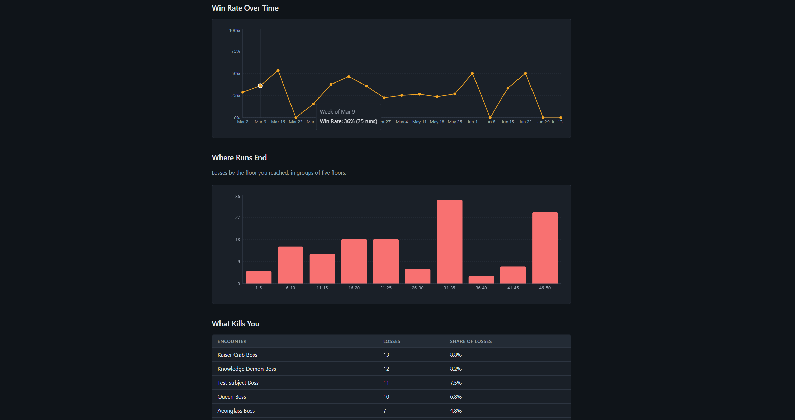
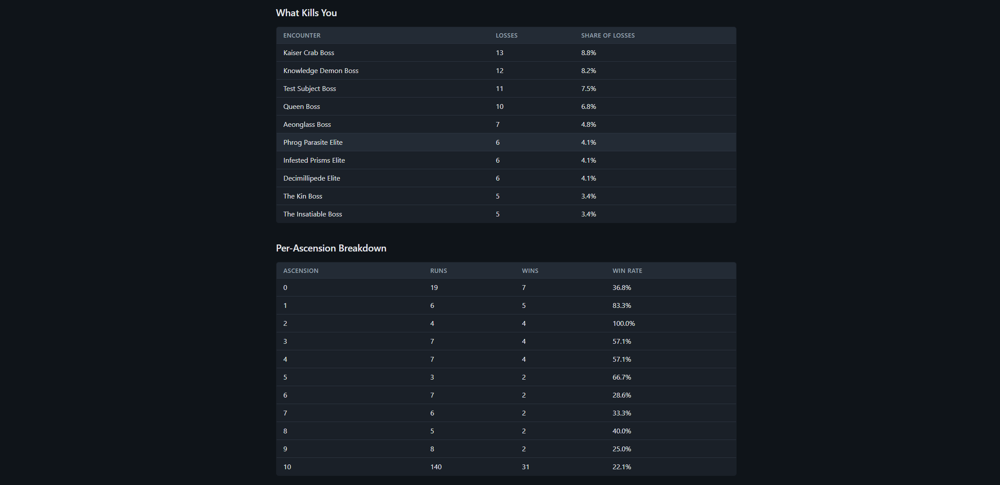
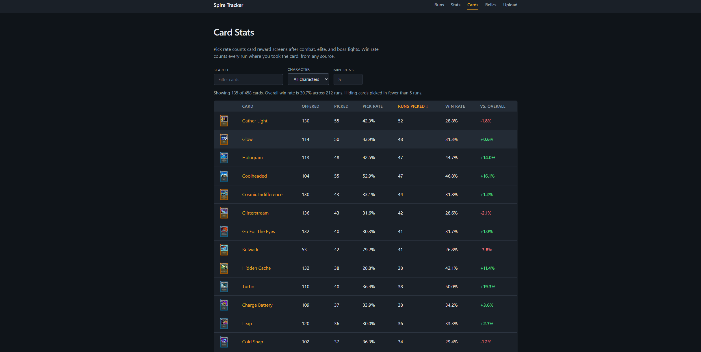
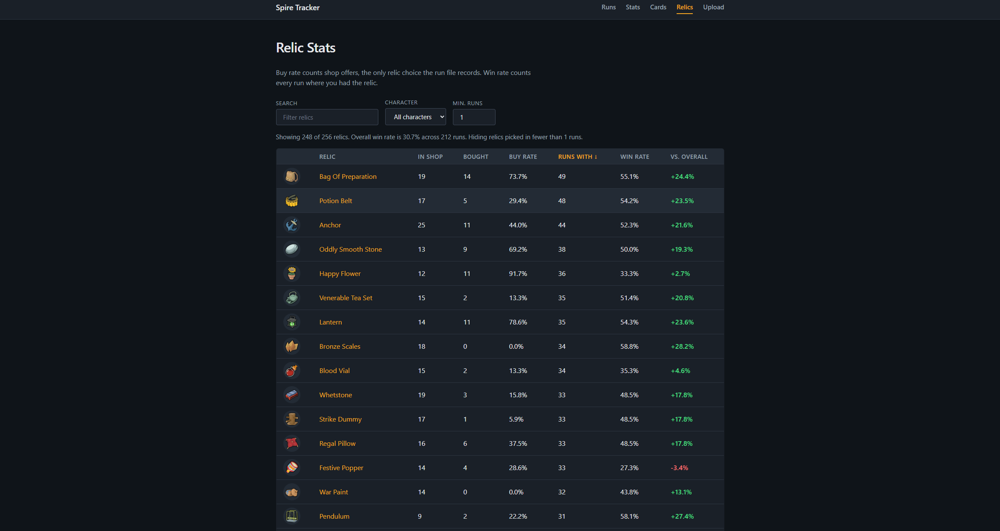

# Spire Tracker

A full-stack web app for tracking and analyzing runs in **Slay the Spire 2**. Upload the game's run history files and get a browsable run history, a floor-by-floor view of every card and relic you were offered, pick rate and win rate for every card and relic, and trends like where your runs end and what kills you. Screenshots of each page located at the end of the README.

## Features

- **Upload** one or many `.run` files at once. Each file is parsed and saved independently, and runs that were already uploaded are skipped, so re-uploading a whole history folder is safe.
- **Run history** with character, result, floor reached, ascension, and date, filterable to runs where you picked a specific card and/or relic. Filters live in the URL, so they can be bookmarked and linked to.
- **Run detail** with an overview of the run and every card choice grouped by floor. Picked cards are highlighted, skipped cards are dimmed, and any card can be clicked to enlarge. Relic choices are listed with their icons.
- **Card and relic stats** for every card and relic: how often it was offered, how often you took it, and your win rate in runs where you had it compared to your overall win rate. Sortable, searchable, filterable by character, with a minimum-sample filter so one-off results don't mislead. Click any card or relic to see the runs where you picked it.
- **Stats dashboard** with overall win rate, best win streak, average run length for wins and losses, win rate by character and over time (weekly), where runs end (losses by floor), the encounters that end the most runs, and a per-ascension breakdown.
- **Card and relic artwork** from the public [Spire Codex](https://spire-codex.com) API.

## Tech stack

| Layer | Technology |
| --- | --- |
| Frontend | React 19, TypeScript, Vite, React Router, Recharts |
| Backend | ASP.NET Core Web API (.NET 10), C# |
| Data | Entity Framework Core, SQLite |
| Tests | xUnit |
| External API | Spire Codex (card and relic metadata and artwork) |

### Data model



### Parser

[`RunParser`](backend/RunAnalyzer.Api/Services/RunParser.cs) turns a run file into a `Run` with its choice rows. It uses `System.Text.Json`'s `JsonDocument` to walk the file directly, since the output shape is intentionally different from the file's shape. Along the way it converts Unix timestamps to `DateTime`, maps the game's `"NONE.NONE"` placeholder to `null`, and records the act and floor of every choice.


### API

| Method | Route | Description |
| --- | --- | --- |
| `GET` | `/api/runs?card=&relic=` | Runs, newest first (summary fields only). Optional `card` and `relic` filter to runs where that item was picked |
| `GET` | `/api/runs/{id}` | One run with its card and relic choices |
| `POST` | `/api/runs/upload` | Upload one or more `.run` files (multipart form, field `files`) |
| `GET` | `/api/stats` | Overall, per-character, per-ascension, weekly, loss-by-floor, and top-killer stats |
| `GET` | `/api/stats/cards?character=` | Pick rate and win rate for every card, optionally for one character |
| `GET` | `/api/stats/relics?character=` | Buy rate and win rate for every relic, optionally for one character |

Responses are DTOs projected directly in the LINQ query, so the API contract is separate from the database schema and large fields like `RunJson` never leave the server.

Simple aggregates (counts, averages, per-character and per-ascension groups, top killers) are translated to SQL by EF Core. Card and relic stats need "distinct runs per item" logic, so they load one flat row per choice and aggregate in [`StatsCalculator`](backend/RunAnalyzer.Api/Services/StatsCalculator.cs).

## Getting started

### Prerequisites

- [.NET 10 SDK](https://dotnet.microsoft.com/download)
- [Node.js](https://nodejs.org/) 20.19+ or 22.12+

### 1. Start the backend

```bash
dotnet dev-certs https --trust     # one time per machine, for https://localhost
cd backend/RunAnalyzer.Api
dotnet run --launch-profile https
```

The API runs at `https://localhost:7041`. The SQLite database (`sts2Runs.db`) is created and migrated automatically on first start.

### 2. Start the frontend

In a second terminal:

```bash
cd frontend
npm install
npm run dev
```

Open `http://localhost:5173`.

To point the frontend at a different API address, copy `frontend/.env.example` to `frontend/.env.local` and change `VITE_API_BASE_URL`.

### 3. Load some runs

Go to **Upload** and select the files in [`samples/`](samples), which are four real runs (two wins, two losses, two characters).

To use your own runs, the game stores them at:

```
%APPDATA%\SlayTheSpire2\steam\<steam-id>\profile1\saves\history\
```

## Running tests

From the repository root:

```bash
dotnet test
```

The tests cover:

- **Parser:** field extraction, timestamp conversion, `Source` mapping, skipping malformed entries, rejecting invalid files, and known values from the sample runs.
- **Stats math:** pick rate sources, counting each run once, win-rate deltas, weekly grouping, floor buckets, and win streaks.
- **Controllers:** the runs filter and stats endpoints against a real in-memory SQLite database, which also checks that the LINQ queries translate to SQL.

## Project structure

```
backend/
  RunAnalyzer.Api/          ASP.NET Core Web API
    Controllers/            HTTP endpoints (runs, stats)
    Services/               RunParser, StatsCalculator
    Entities/               EF Core entity classes
    DTOs/                   API response shapes
    Data/                   DbContext
    Migrations/             EF Core migrations
  RunAnalyzer.Api.Tests/    xUnit tests (parser, stats math, controllers)
frontend/
  src/
    pages/                  One component per route
    components/             Shared UI (nav bar, item filter, chart theme)
    context/                Spire Codex catalog provider and useCatalog hook
    api/                    fetch wrappers for the backend
    types/                  TypeScript types matching the API DTOs
    utils/                  Formatting and grouping helpers
    styles/                 Global styles and design tokens
samples/                    Example .run files
```

















